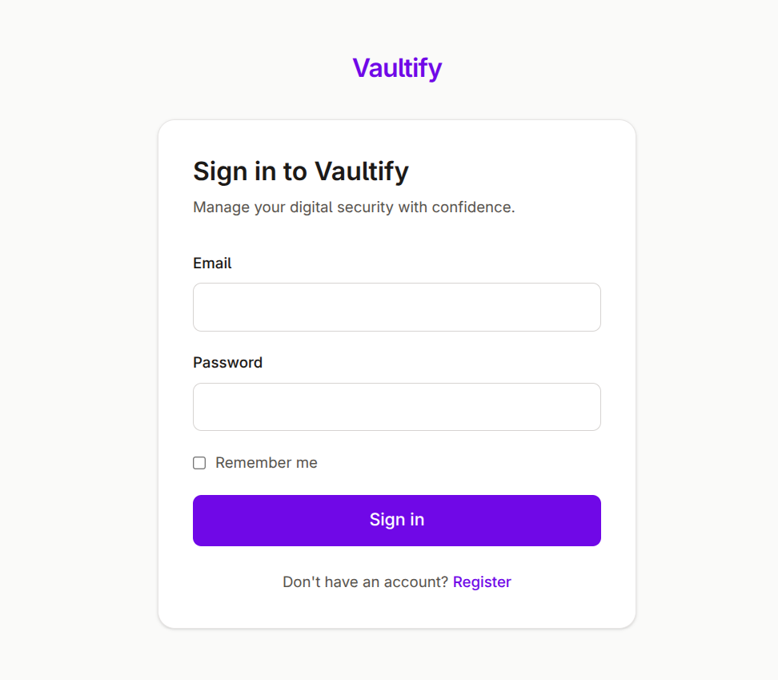
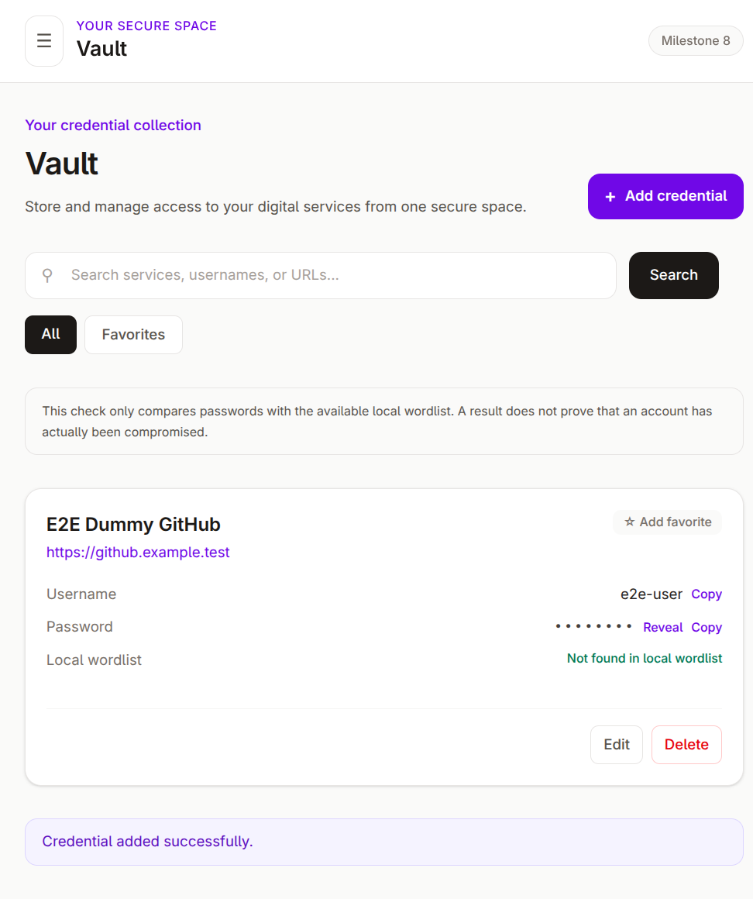
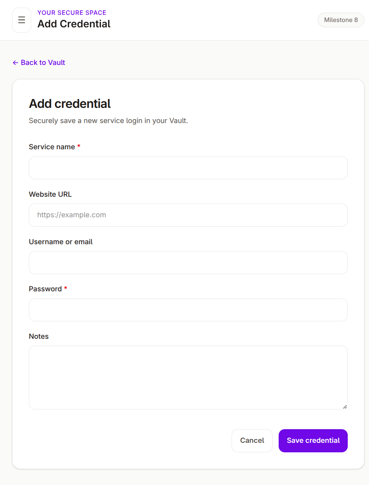
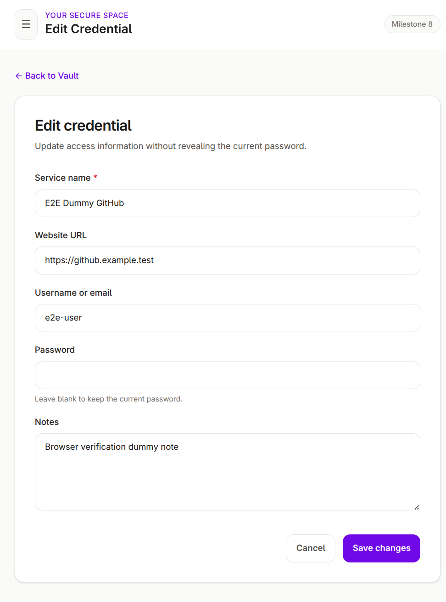
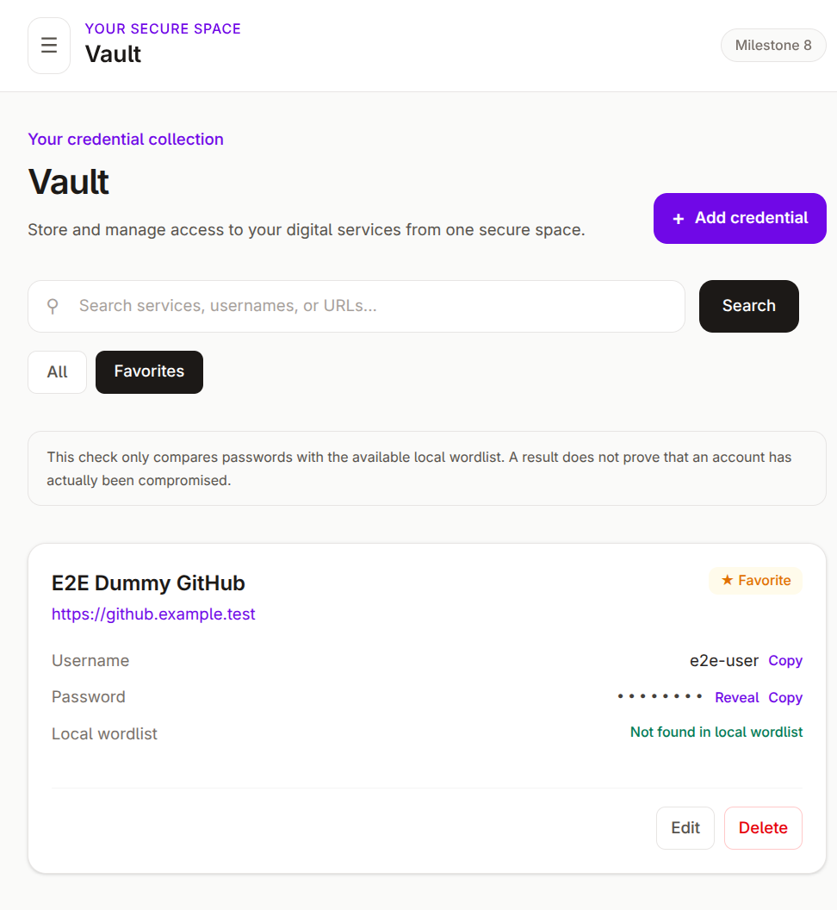
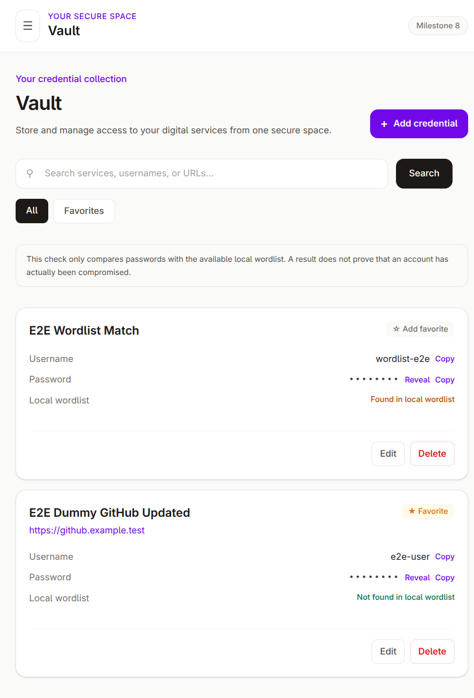
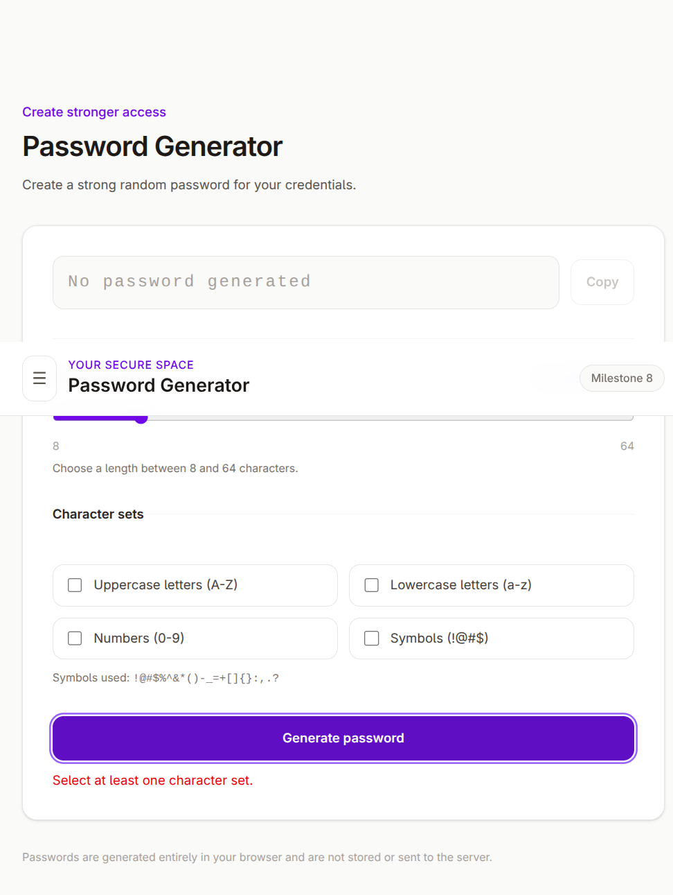
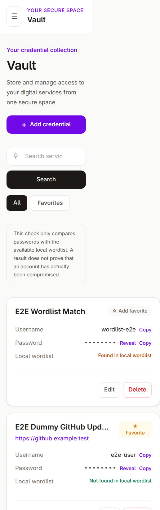

# Laporan Proyek Vaultify

## Ringkasan

Vaultify adalah password manager pribadi berbasis Laravel, Blade, Tailwind CSS,
dan JavaScript vanilla. Fitur yang tersedia mencakup autentikasi manual, vault
credential terenkripsi, pencarian, favorit, reveal/copy yang terlindungi, generator
password berbasis Web Crypto API, dan validasi terhadap wordlist lokal.

## Keamanan dan privasi

- Password login menggunakan hashing Laravel.
- Password dan catatan credential menggunakan enkripsi Laravel `Crypt`.
- Akses credential dibatasi melalui relasi pengguna yang sedang login.
- Password tidak dikirim pada HTML awal halaman Vault.
- Endpoint reveal/copy menggunakan POST, CSRF, ownership check, dan `Cache-Control: no-store`.
- Generator password tidak mengirim hasil ke server atau browser storage.
- Dataset wordlist lokal disimpan di `storage/app/private/wordlists/` dan diabaikan Git.

## Dataset wordlist

Dataset pengujian yang digunakan adalah dataset sintetis lokal berisi 120 entri.
Dataset tersebut tidak berasal dari database kredensial bocor dan tidak memuat
data pengguna. Import dapat diulang dengan:

```bash
php artisan wordlist:import storage/app/private/wordlists/vaultify-synthetic-20261026.txt
```

Importer menangani baris kosong, line ending Unix/Windows, duplikasi, dan entri
yang melebihi batas. Pencocokan bersifat exact dan case-sensitive.

## Pengujian

Feature test Laravel dipaksa menggunakan SQLite in-memory oleh `phpunit.xml` dan
guard di `tests/TestCase.php`. Test tidak dimaksudkan untuk menggunakan MySQL
development. Build frontend menggunakan Vite dan pemeriksaan format menggunakan
Laravel Pint.

## Arsitektur, skema, dan algoritma

Autentikasi manual memakai session Laravel, middleware `guest`/`auth`, rate limiting,
regenerasi session setelah login, dan CSRF pada mutation. Credential selalu diambil melalui
relasi user yang terautentikasi sehingga ID milik user lain menghasilkan 404.

Tabel `credentials` memiliki foreign key `user_id` ke `users.id` dengan cascade delete,
`TEXT` untuk `password_encrypted`, `LONGTEXT` untuk `notes_encrypted`, flag favorit, dan
status pemeriksaan wordlist. Tabel `password_wordlist` memiliki unique index dan collation
binary MySQL. Password serta catatan memakai `Crypt::encryptString()` dengan `APP_KEY`;
password login memakai hashing dan tidak dapat didekripsi.

Generator memakai Web Crypto API `crypto.getRandomValues()`, rejection sampling, dan
Fisher-Yates shuffle. Panjang 8--64 dan kategori aktif masing-masing menyumbang satu karakter.

Wordlist diimport streaming melalui `wordlist:import`; blank line, line ending Windows/Unix,
duplikasi, dan entri terlalu panjang ditangani tanpa mencetak nilai password. Setelah import,
credential yang valid diperiksa ulang dan ciphertext invalid dilewati.

## Bukti dan screenshot

Screenshot berikut dibuat dari aplikasi yang sedang berjalan dengan data dummy:

















Hasil aktual terakhir: 32 test dan 159 assertion lulus, Pint lulus, Vite build lulus,
enam migration berstatus `Ran`, MySQL memakai database `vaultify`, dan wordlist berisi
120 entri. Import ulang menghasilkan 0 entri baru dan 120 duplikat. Missing CSRF pada web
runtime menghasilkan HTTP 419. Data akun dan credential dummy E2E sudah dibersihkan.

## Batasan yang diketahui

Database development pernah ditemukan tanpa data pengguna dan credential. Tidak
ada backup data yang terverifikasi, sehingga data lama tidak diklaim telah
dipulihkan. Audit ini tidak menghapus atau mereset database dan tidak membuat
data pengganti yang menyamar sebagai data lama.
